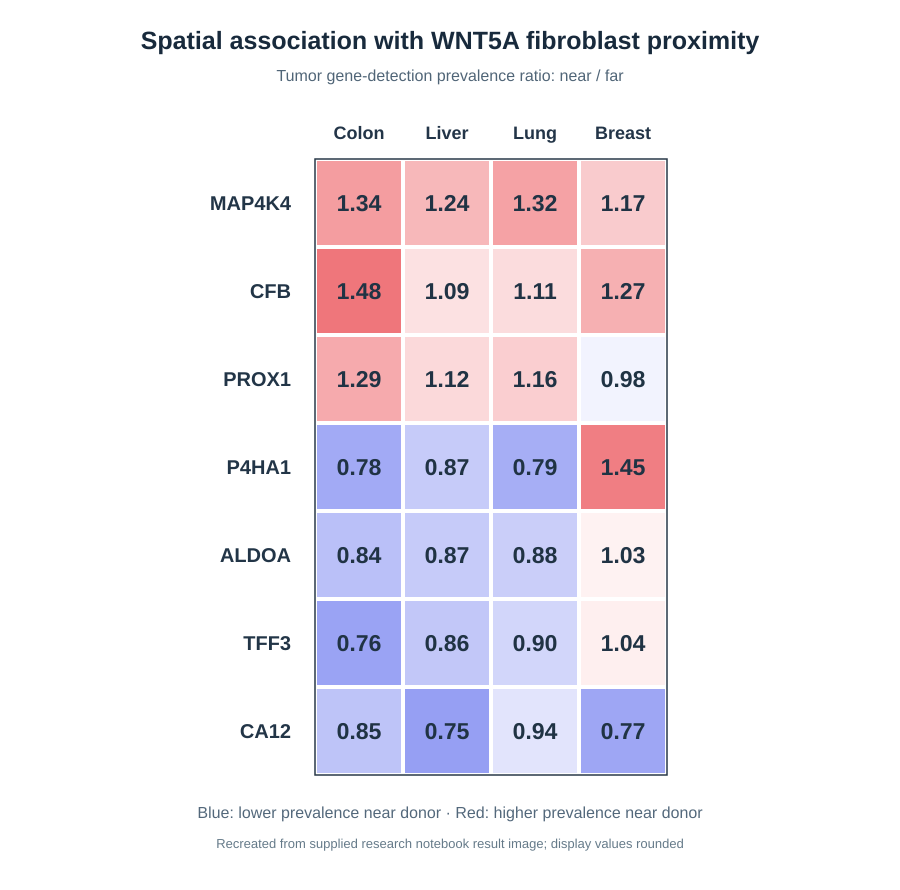

# Spatial transcriptomics: interpretable spatial-rule discovery in metastatic colorectal cancer

**Custom computational methods | Xenium spatial transcriptomics | Computational oncology | Interpretable ML**

Research prototypes developed in the Ding Lab context to discover **where the tumor microenvironment is associated with altered cell states** and **which combinations of nearby cell-type/gene features distinguish those states**. The analyses use spatially resolved, single-cell Xenium gene expression from metastatic colorectal cancer (mCRC), including colon and metastatic tissue sections.

Rather than treating gene expression as an unordered cell-by-gene matrix, this work introduces **geometric neighborhood structure**, **cell-type-conditioned contrasts**, and an **interpretable combinatorial rule search**. The goal is biological hypothesis generation, not a black-box predictive benchmark or a claim of causal cell–cell signaling.

## Research contributions

| Research module | Computational approach | Biological question | Main implementation |
| --- | --- | --- | --- |
| **1. Morphology-based spatial differential expression** | Rasterized cell occupancy, disk-shaped binary dilation, vectorized index mapping, near/far gene-prevalence contrasts | Which tumor/receiver genes associate with proximity to a specified donor population? | [`fast_morph_scripts`](fast_morph_scripts/) + [`filter_algorithm_morph`](filter_algorithm_morph/) |
| **2. MorphCIA: interpretable neighborhood logic discovery** | KD-tree donor-neighbor selection, cell-type × gene neighborhood tensors, prevalence filtering, exhaustive two-feature Boolean gates | Which combinations of neighboring cellular features distinguish receiver-gene-positive from negative cells? | [`morphcia`](morphcia/) |
| **Data & execution infrastructure** | Seurat/BANKSY metadata integration, per-section exports, shell-level bounded parallelism | How can annotated Xenium data be transformed and processed across sections? | [`Seurat_to_python`](Seurat_to_python/) + [`run_morphcia_with_wait`](run_morphcia_with_wait/) |

### 1 — Spatial morphology as feature engineering

For a selected **donor cell type** and **receiver cell type**, map centroid coordinates to a shared grid; dilate the donor occupancy map by a disk of radius `round(distance_threshold / grid_size)`; then partition receiver cells according to whether they fall inside that spatial neighborhood. The reusable helper returns original receiver-cell indices, so downstream analysis can operate on the corresponding high-dimensional gene-expression rows.

The accompanying research design computes the per-gene near/far **expression-detection prevalence ratio**:

```text
enrichment(gene) = P(receiver gene detected | near donor)
                   / P(receiver gene detected | far from donor)
```

The presentation outlines two-proportion z-tests and post-filtering (illustrative `p < 0.05`, ≥10% expression prevalence, mean ratio ≥1.5 across samples). **The small morphology helper implements the geometric split, not those tests.** The historical notebook and slides provide the broader analysis context.

### 2 — MorphCIA: interpretable, combinatorial spatial features

Condition on receiver-cell expression of a gene of interest (e.g., `PROX1`). For each receiver cell sufficiently close to a specified donor population, compute a neighborhood representation across **cell type × neighboring gene**, using `max`, `sum`, or `mean` expression aggregation. Compare feature prevalence between receiver-gene-positive and -negative populations.

After prevalence filtering, the implemented search evaluates **six Boolean operators** across pairs of candidate cell-type/gene features: **AND, OR, XOR, NAND, NOR, XNOR**. These are human-interpretable candidate rules rather than fitted neural-network weights. For `K` retained features, there are `6 × K(K−1)/2` operator/pair candidates per receiver target, evaluated on binary neighborhood-feature matrices (subject to implementation-specific filtering).

## Biological results: organ-stratified spatial associations

The exploratory heatmap below was **redrawn from the supplied `filter_algorithm_morph.ipynb` result screenshot** (rounded display values). Numbers indicate the ratio of receiver-gene detection prevalence **near vs. far** from `fibroblast_WNT5A` donor cells. Values above one indicate positive spatial association; values below one indicate negative association.



**Interpretable examples from the figure:** `MAP4K4` shows ratios of **1.34 / 1.24 / 1.32 / 1.17** across colon/liver/lung/breast. `CA12` is below one in all four organs (**0.85 / 0.75 / 0.94 / 0.77**). `P4HA1` changes direction—from **0.78–0.87** in colon/liver/lung to **1.45** in breast—illustrating the value of organ-specific analysis over indiscriminate pooling. These are descriptive associations, not effect sizes from a causal intervention.

A complementary **MorphCIA** presentation example identifies an `AND` combination of **`fibroblast_WNT5A:C1R`** and **`tumor:IQGAP2`** near `PROX1`-stratified receiver cells: positive/negative gate prevalence **0.6885 vs 0.4044 (1.70×)** in colon and **0.6061 vs 0.4036 (1.50×)** in liver. These are reported exploratory results from the research presentation, **not independently reproduced in this checkout**.

## Repository map

| Folder | Why it matters |
| --- | --- |
| [`Seurat_to_python/`](Seurat_to_python/) | Converts annotated Seurat/BANKSY Xenium objects and cell centroids into analysis-ready per-section tables |
| [`fast_morph_scripts/`](fast_morph_scripts/) | Reusable spatial discretization, binary dilation, and receiver-index recovery |
| [`filter_algorithm_morph/`](filter_algorithm_morph/) | Experimental notebook and biological near/far expression analysis |
| [`morphcia/`](morphcia/) | KD-tree-conditioned neighborhood representations and Boolean rule mining |
| [`run_morphcia_with_wait/`](run_morphcia_with_wait/) | PID-tracked, concurrency-limited post-processing job launcher |

## Technical profile

**Methods:** spatial feature engineering; raster morphology; nearest-neighbor search (`scipy.spatial.cKDTree`); high-dimensional array operations; stratified prevalence comparisons; hypothesis-driven, interpretable logic-rule enumeration; tissue-specific exploratory analysis.

**Stack:** Python, NumPy, pandas, SciPy, scikit-image, joblib, Jupyter; R, Seurat, BANKSY annotations, data.table; Bash/Conda. This is research software with lab-specific data dependencies rather than a turnkey public benchmark.
