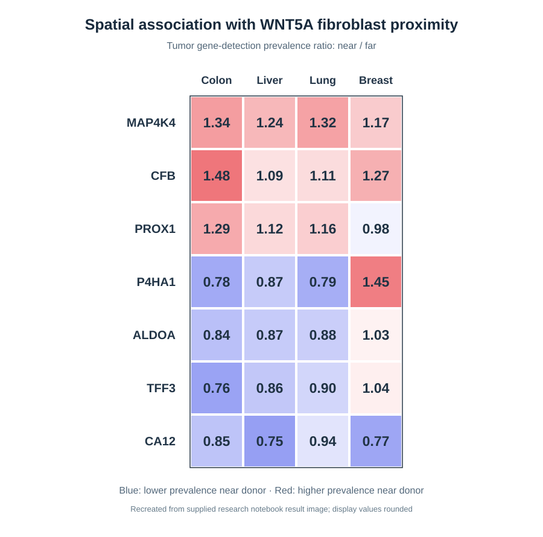

# Morphology-based spatial gene association discovery

**Original research prototype · Spatial transcriptomics · Statistical feature discovery · Computational oncology**

## Scientific objective

Identify receiver-cell genes whose **probability of detection** varies with proximity to a particular donor-cell population—and determine whether those relationships are **shared across anatomical sites or tissue-context-dependent**.

[`filter_algorithm_morph.ipynb`](filter_algorithm_morph.ipynb) is the historical exploratory analysis notebook for **Part 1** of the Ding Lab spatial logic-search framework. It links a custom morphological neighborhood representation to interpretable, organ-stratified outputs from metastatic colorectal cancer Xenium data.

## Featured result — tumor cells near WNT5A fibroblasts

*Figure redrawn from the user-supplied notebook heatmap, retaining its displayed (rounded) values. Each number is a **near/far detection-prevalence ratio** for tumor cells comparing proximity to `fibroblast_WNT5A` versus more distant tumor cells. Red = greater than 1; blue = less than 1. These are descriptive observational associations.*

The result reveals biologically interpretable structure rather than a single pooled association:

- **Consistent enrichment:** `MAP4K4` = **1.34** (colon), **1.24** (liver), **1.32** (lung), **1.17** (breast).
- **Consistent depletion:** `CA12` = **0.85**, **0.75**, **0.94**, **0.77**, respectively.
- **Tissue-context dependence:** `P4HA1` = **0.78 / 0.87 / 0.79** in colon/liver/lung, but **1.45** in breast.
- **Additional signals:** `CFB` = **1.48** in colon; `TFF3` = **0.76** in colon.

These observations illustrate why **cell-type-conditioned, tissue-stratified spatial features** can expose heterogeneity that global differential expression or pooled tissue analysis may obscure. They do **not** establish fibroblast-to-tumor signaling or statistical significance of the displayed individual ratios.

## Computational approach

The companion methods presentation (`logic_search.pdf`, Part 1) describes this workflow:

1. **Spatial encoding:** align receiver/donor centroids on a shared 2-D grid (illustrated `grid_size=5`).
2. **Morphological neighborhood construction:** dilate donor occupancy with a disk representing a spatial radius (illustrated `distance_threshold=30`).
3. **Cohort stratification:** partition receiver cells/grids into **inside** and **outside** the donor neighborhood.
4. **Binary expression mapping:** for each receiver gene `g`, label expression as detected/not detected within each comparison group.
5. **Group-level statistics:** estimate `P(g>0 | near)` and `P(g>0 | far)`; compute their ratio; the research design describes a **two-proportion z-test**.
6. **Candidate screening and visualization:** the presentation proposes `p<0.05`, at least 10% expression positivity in a group, and ≥1.5 average fold change across samples, followed by organ-specific heatmaps.

**Implementation provenance:** [`../fast_morph_scripts/fast_morph_scripts.py`](../fast_morph_scripts/fast_morph_scripts.py) directly implements the spatial partition. The full 6.4 MB notebook is a saved exploratory research artifact; the complete notebook has **not been independently executed or line-by-line audited** in this documentation update. Do not interpret every presentation setting or proposed statistical step as verified notebook code.

## Research significance for AI/biotech

The central design choice is **biologically structured feature engineering**: gene expression is analyzed conditional on cell identity, tissue context, and local spatial geometry. This produces **interpretable, testable hypotheses** about microenvironmental associations, including organ-dependent relationships.

The method is complementary to—rather than equivalent to—predictive ML: it discovers structured correlates, not a fitted model or validated causal network. For follow-up studies, important extensions are FDR control, exact-neighbor sensitivity tests, patient/section-level uncertainty, segmentation artifact checks, and independent validation.

**Inputs/reproduction:** original Xenium cell tables and sample metadata are not committed; adapt lab-specific paths and verify spatial units, count thresholds and non-independent cells before re-analysis.
